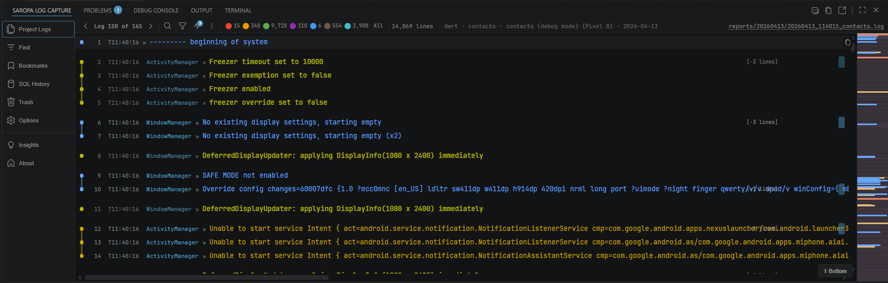
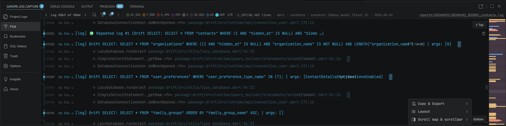
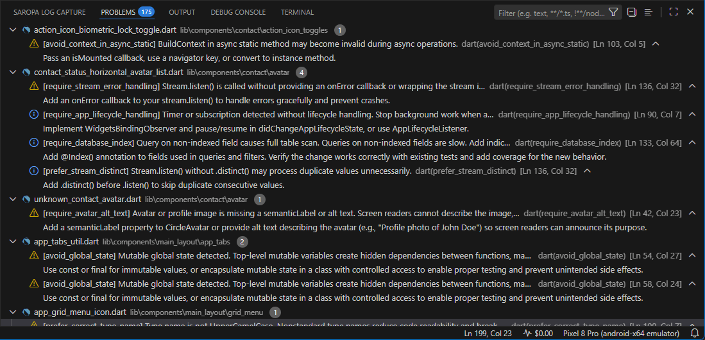
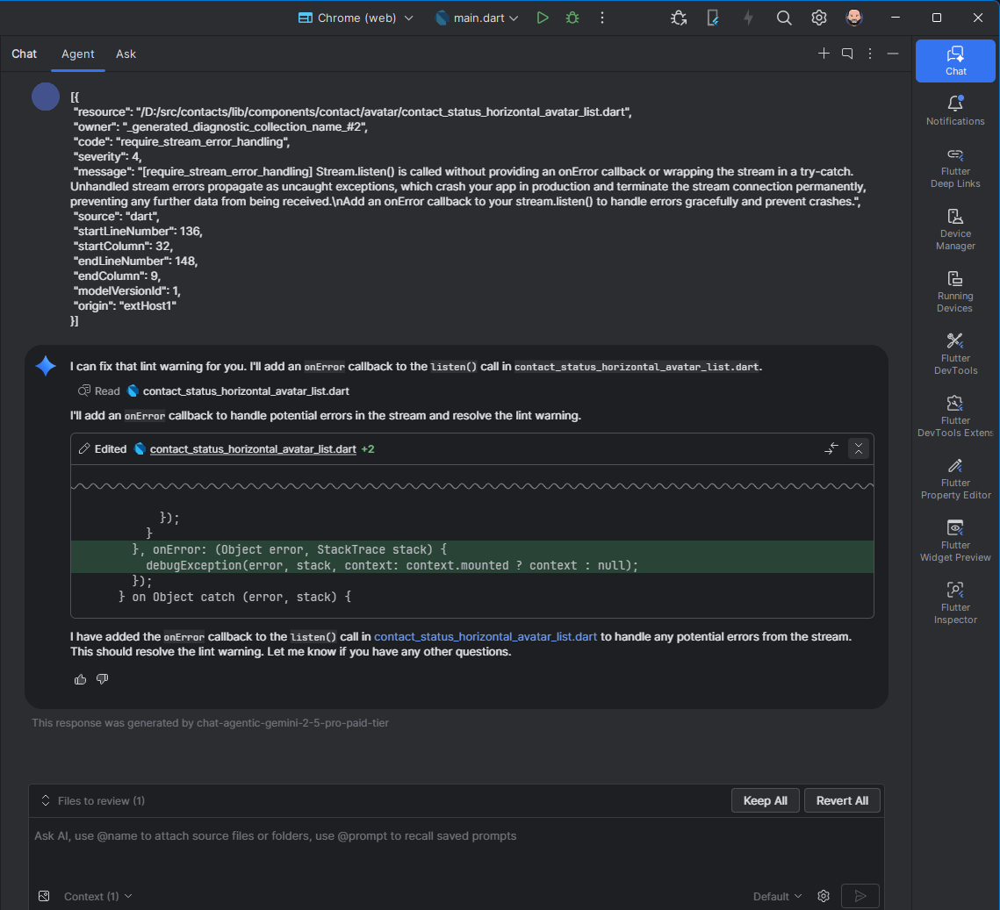
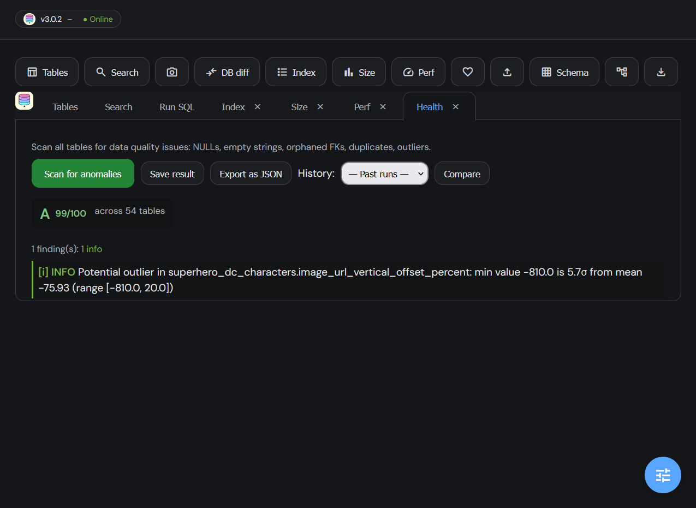
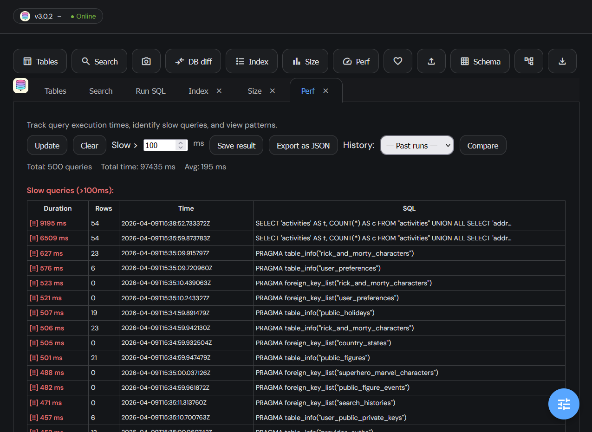

# Saropa Suite

One-click install for the full Saropa developer toolkit. **Saropa Suite** bundles five powerful VS Code extensions to fortify your Flutter and Dart development workflow, providing persistent capture of debug output, strict behavioral analysis, comprehensive local database diagnostics, a fast project-aware launcher for your files and scripts, and full-text search of your Claude Code session history.

---

## ⚡ Suite Integrations: Better Together

Installing the full Saropa Suite unlocks native, cross-extension APIs that dramatically speed up your workflow:

* **Capture + Lints:** Exported bug reports become actually useful. Saropa Capture natively cross-references runtime errors with static analysis findings. It embeds lint violations (filtered by impact), OWASP executive summaries, and overall project health scores directly into your logs. Stale lint data is automatically refreshed before report generation.
* **Capture + Drift:** Your debugging sessions now carry deep database context. Session metadata bundles query performance stats, schema summaries, anomaly counts, and index suggestions. Right-click any SQL line in your logs to instantly "Open in Saropa Drift" to profile and optimize the query. Root-cause log hints will actively reference Drift database issues.
* **Workspace + the suite:** Pin the rest of the toolkit's entry points as one-click favorites — run a Lints analysis, launch a Saropa Capture repro script, or kick off a Saropa Drift seed/migration — so the tools you installed together are always one action away, from a single sidebar. Saropa Capture also exposes a signal-delta API: bracket a command run with two log markers and ask what errors, warnings, or performance signals changed in between.
* **Chats + the suite:** Find the Claude Code session that worked on your project. Search your session history by word, file, command, branch or PR, see which session edited a file, and resume it from the sidebar.

```
┌─────────────────────────┐         ┌─────────────────────────┐
│     Saropa Workspace    │         │       Saropa Chats      │
│  Pin & run files,       │         │  Search & resume Claude │
│  scripts, entry points  │         │  Code session history   │
└────────────┬────────────┘         └────────────┬────────────┘
             │  Launches                         │  Session search
             └─────────────────┬─────────────────┘
                               ▼
                     ┌───────────────────┐
                     │   SAROPA  SUITE   │
                     └─────────┬─────────┘
               ┌───────────────┴───────────────┐
               │                               │
  ┌────────────┴─────────────┐   ┌─────────────┴────────────┐
  │       Saropa Lints       │   │       Saropa Drift       │
  │                          │   │                          │
  │  Static Behavioral &     │   │  Local DB Analysis &     │
  │  Security Analysis       │   │  Query Profiling         │
  └────────────┬─────────────┘   └─────────────┬────────────┘
               │                               │
               │  Injects OWASP summaries,     │  Syncs SQL stats
               │  health scores, and lint      │  context.
               │  violations.                  │
               │                               │
  ┌────────────┴───────────────────────────────┴─────────────┐
  │                     Saropa Capture                       │
  │         Persistent Runtime Logging & Navigation          │
  └──────────────────────────┬───────────────────────────────┘
                             │
                             │  Generates
                             │
                  ┌──────────┴──────────────────────────┐
                  │  Context-Rich Exported Bug Reports  │
                  └─────────────────────────────────────┘
```

---

## 🛠️ What's Included

###  [Saropa Capture](https://marketplace.visualstudio.com/items?itemName=saropa.saropa-capture)
**Intelligent, Persistent Logging:** The Debug Console is deleted the moment you stop debugging — Saropa Capture fixes that. It automatically saves all debug session output to persistent, searchable log files and provides a full diagnostic workstation inside VS Code.

- **Zero-config capture** — works with any debug adapter (Dart, Flutter, Node, Python, C++, Go, Java). Install, press F5, done.
- **Virtual-scrolling viewer** — handles 100K+ lines without lag, with real-time severity filtering across 8 levels, regex search with history, and click-to-source navigation.
- **Smart error classification** — auto-classifies errors (CRITICAL, TRANSIENT, BUG) with inline badges, fingerprints recurring patterns across sessions, and detects ANR risk, N+1 queries, and slow operations.
- **Crashlytics & Vitals panel** — pulls Firebase Crashlytics issues and Google Play crash-free users/sessions into VS Code, with per-issue trend sparklines, "Regressed"/"Repetitive" tags, issue archiving, background new-crash alerts, and deep-links straight to the matching Firebase issue.
- **Unified signal analysis** — aggregates errors, warnings, performance, SQL, network, and memory signals across sessions with trend tracking (↑ stable ↓), co-occurrence detection, and evidence-backed reports with surrounding context.
- **SQL diagnostics** — query fingerprinting, N+1 detection, slow query burst markers, and cross-session SQL comparison with Drift ORM support.
- **Session management** — side-by-side session comparison (2 or 3 logs at once), session replay with scrubber/speed controls, an interactive Session Flow Map diagram with pan/zoom and per-node detail, deep links (vscode:// URLs), active case investigations, and collapsible daily groupings.
- **Rich export** — HTML (static or interactive), CSV, JSON, JSONL, shareable `.slc` bundles, Grafana Loki push, and markdown with full metadata. Per-level export presets (Errors Only, Production Ready, Full Debug, Performance Analysis).
- **Safer sharing** — exports redact bearer/Authorization tokens, query-string secrets, and user-home paths, and "Explain with AI" prompts flag captured log text as untrusted data so a model never treats it as instructions.
- **Sibling-extension API** — `insertMarker()` and `getSignalDelta()` let other tools bracket a run with markers and read back the errors, warnings, and performance signals that changed.
- **Seamless rename** — existing `saropaLogCapture.*` settings are migrated on first start and old command IDs stay registered as aliases. Uninstall the old "Saropa Log Capture" extension after installing Saropa Capture.
- **20+ integration adapters** — opt-in session context from Git state, test results, code coverage, crash dumps, Docker, performance snapshots, terminal output, HTTP/network, browser DevTools, and more.




###  [Saropa Lints](https://marketplace.visualstudio.com/items?itemName=saropa.saropa-lints)
**Strict Behavioral Analysis:** 2,300+ custom lint rules and 250+ quick fixes that go far beyond syntax — catching the runtime errors, memory leaks, and security vulnerabilities that standard linters miss entirely.

- **Behavioral detection** — catches code that compiles but fails at runtime: undisposed controllers, `setState` after dispose, `GlobalKey` recreation, hardcoded credentials. Uses proper AST type checking, not string matching.
- **Library-specific audits** — 50+ rules per popular package (GetX, Riverpod, Bloc, Provider, Firebase, Isar, Hive, Dio, GraphQL, Supabase, Flutter Hooks, and more) targeting anti-patterns unique to each library.
- **OWASP-mapped security** — 60+ rules across all 10 OWASP Mobile Top 10 (2024) categories with compliance export for security audits. Covers hardcoded credentials, unsafe deserialization, insecure HTTP, weak cryptography, and injection vulnerabilities.
- **5-tier adoption system** — Essential (~300 rules) → Recommended (~950) → Professional (~1800) → Comprehensive (~1870) → Pedantic (~1880), with baseline mode for legacy codebases. Adopt gradually without fixing all existing violations.
- **Platform & accessibility rules** — 90+ iOS-specific rules (Safe Area, Privacy Manifest, Face ID, HealthKit), 11+ Android rules, macOS/Web/Desktop rules, and EAA (European Accessibility Act) compliance checks.
- **Package Vibrancy scoring** — dependency health scanning with ecosystem adoption metrics, replacement complexity analysis, file usage tracking, GitHub issues/PRs counts, README galleries, and version-gap PR triage.
- **VS Code dashboard** — health score (0–100), issues tree grouped by severity/file/rule, OWASP coverage matrix, file risk rankings, rule triage UI, score trends over time, and a searchable catalog of 117+ commands.
- **AI-optimized diagnostics** — every diagnostic is formatted as a paste-ready AI repair prompt for Cursor, Copilot, and Windsurf.
- **Cross-file CLI** — detect unused files, circular imports, and generate import graphs (DOT format for Graphviz). The `scan` command takes `--files`, `--exclude-globs`/`--include-globs`, and `--strict-files` (exit non-zero if any named file is skipped) for CI.
- **Rules & Tiers control** — turn a rule off straight from a rule-search result or the "Explain rule" panel, without a trip to the Overrides tab.




###  [Saropa Drift](https://marketplace.visualstudio.com/items?itemName=saropa.drift-viewer)
**Deep SQLite/Drift Debugging:** A two-client debug platform — a lightweight HTTP server in your app (zero third-party runtime dependencies) paired with both a browser UI and a VS Code extension. Not just a table viewer; a complete database diagnostic suite.

- **Data browsing** — multi-table tabs with foreign key navigation and breadcrumb trails, PII masking (50+ column patterns), data type toggle (raw SQLite ↔ human-readable), and one-click cell copy.
- **Query tools** — a **SQL Console** in the sidebar (statements are checked as you type; writes ask before running; last 20 kept in history), SQL runner with autocomplete and 200-entry history, visual query builder (SELECT/WHERE/ORDER BY/LIMIT), natural language "Ask in English" → SQL, multi-statement **SQL Notebook**, and color-coded **EXPLAIN panel** with index suggestions.
- **Data visualization** — bar, stacked bar, pie, line, area, scatter, and histogram charts from SQL results with PNG/SVG export.
- **Data quality** — suppress a diagnostic by column name across every table, anomaly detection (NULLs, orphaned FKs, duplicates, numeric outliers with severity), health score (0–100 with letter grade A–F), index suggestions with ready-to-use SQL, and storage analytics with table sizes and journal mode.
- **Schema intelligence** — live schema SQL, ER diagrams with FK relationship lines, schema diff (code-defined vs runtime), offline Dart workspace scanning for Drift `Table` classes, Isar-to-Drift converter, migration preview/codegen, and rollback generator.
- **Time travel** — snapshots with diff comparison and export, timeline auto-capture on data change, database comparison (schema match, row counts, migration DDL), row comparator, and query regression detection across sessions.
- **Performance profiling** — query execution times, slow-query detection (configurable threshold), mutation stream with real-time INSERT/UPDATE/DELETE feed, and watch panel with live polling and diff highlighting.
- **Collaboration** — shareable session URLs with annotations and expiry, portable self-contained HTML reports, CSV/JSON/SQL dumps, and raw `.db` download.
- **Security** — secure-by-default (loopback-only binding, no wildcard CORS) with a read-only posture (writes require explicit callback), bearer token or HTTP Basic auth, rate limiting, and session TTL.
- **Four themes** — Light, Showcase (glassmorphism with animated gradients), Dark, and Midnight (deep navy with aurora glow), with OS dark-mode sync.




###  [Saropa Workspace](https://marketplace.visualstudio.com/items?itemName=saropa.saropa-workspace)
**Project-Aware Launcher:** Pin any file or script as a favorite — single-click to open it, double-click to run it. Turns the configs, docs, and scripts you reach for constantly into one-action shortcuts from a dedicated sidebar.

- **Pin & open** — pin from the editor title or Explorer right-click into **Project Pins** (stored in `.vscode/saropa-workspace.json`, shared through the repo) or **Global Pins** (synced via VS Code Settings Sync). Single-click opens.
- **Run scripts** — double-click (or the inline play button) runs a pinned script with its own command prefix, CLI args, working directory, and environment. Choose the integrated terminal or a background output channel; placeholder and interactive tokens parameterize one pin instead of many.
- **Schedule** — run a pinned script at a time of day, on a repeating interval, or both, in-process while VS Code is open, with the next run shown in the status bar.
- **Recipes & run-target inference** — auto-detected pins from your `.git/config` and manifests (open the repo/PR/CI, run dev/test/lint/build, `docker compose up`, db migrate), plus the right run command inferred from `package.json` scripts, a Makefile, or a shebang.
- **Organize & access fast** — named groups with drag-to-reorder, per-pin icon and color, a **Recent** group, **Run Pin…** palette quick-pick, and bindable **Run Top Pin 1–5** keybindings.
- **HubGrid** — a table of open issues and pull requests from every watched GitHub repo, newest first, with per-repo filters, new-item dots, and rate-limit notices.
- **Release Board** — a Gantt and board view of the work items in your project's `plans/` and `bugs/` documents: what blocks the next release, what comes first, an "Up next" list, per-project status, and groups you can rename, recolor, merge, or tag.
- **Auto-pins, suggestions & import** — common project files surfaced automatically, a pin suggestion for files you open often, and one-time import of existing `.favorites.json` shortcuts.

###  [Saropa Chats](https://marketplace.visualstudio.com/items?itemName=saropa.claude-chat-explorer)
**Search and Resume Claude Code Sessions:** Full-text search of your Claude Code session history. Find an old session by any word or phrase, see which session edited a file, check a session's git state, and resume it from the sidebar. Indexes `~/.claude/projects` locally in a worker thread, with no runtime dependencies.

- **Full-text search** — includes subagent transcripts, with search tokens (`file:`, `edited:`, `cmd:`, `tag:`, `sha:`, `pr:`, `branch:`, `from:`, `last:`), exact-phrase, any-order, case, whole-word and regex matching, and filters by time, sender and scope.
- **Resume from the sidebar** — click a result to resume that session (needs the Claude Code extension), or expand it to read the matching messages. A **New session** button starts a fresh one, and **Clean up** archives every session except the ones open or pinned (nothing is deleted).
- **Which session edited this file?** — from the Explorer, editor or tab menu.
- **Git state in each session card** — branch, open pull request, uncommitted files, unpushed commits and worktrees, plus a Project Status page grouping branches, worktrees, PRs and sessions by what to do next.
- **Live status** — status dots for running, waiting, unread and background sessions, a count badge for sessions waiting on you, and a warning when a live session nears a full context window.
- **Activity diagram** — a live diagram under the session list that flashes as Claude chats, reads memory and files, runs terminal commands, browses the web, or calls agents; it shows when Claude is waiting for you and flags errors.
- **Account & Usage** — a simple view that follows the native Claude Code layout: your account and plan, tokens used in the last 5 hours, today and the last 7 days, plus per-session and per-branch totals, plus a read-only Claude Config review.
- **Local by default** — sessions are indexed on your machine. The pull request lookup (on by default, can be turned off) runs your own `gh` command; Web (cloud) sessions are off unless you opt in.

---

## 📦 Foundation Library: Saropa Dart Utils

### [Saropa Dart Utils](https://pub.dev/packages/saropa_dart_utils)
**280+ production-hardened extension methods** extracted from real Flutter apps — null-safe accessors, parsing/validation helpers, collection and date utilities, with edge cases (empty, null, Unicode, extremes) already handled.

This is a pure Dart **library**, not a VS Code extension — so it is not bundled in the install. It is the suite's **remediation layer**: the safe primitives the other tools' fixes steer you toward.

- **Migration scanner (available today)** — the package ships a `suggest_saropa_utils` command-line scanner that walks your project, finds hand-rolled code the library already solves, and prints the helper to use instead (e.g. a manual `name[0].toUpperCase() + name.substring(1)` → `name.capitalize()`). Every suggestion is audited against the real API and checked to not degrade your code.
- **Crash-to-fix loop (concept)** — where Lints maps a crash class to the rule that prevents it (`.first` on an empty list, an out-of-range index), the matching safe helper lives in this library.
- **In-editor diagnostics + version-upgrade nudge (planned)** — porting the scanner's patterns into Saropa Lints (in-editor quick fixes) and surfacing out-of-date `saropa_dart_utils` through Package Vibrancy are the next step, not yet shipped.

---

## 🚀 Getting Started

1. Install **Saropa Suite** from the [VS Code Marketplace](https://marketplace.visualstudio.com/items?itemName=saropa.saropa-suite).
2. All five extensions are installed and activated automatically.
3. No configuration required — each extension works out of the box.

---

## 💬 Contact & License

**Email:** [saropa.suite@saropa.com](mailto:saropa.suite@saropa.com)  
**License:** [MIT](LICENSE)